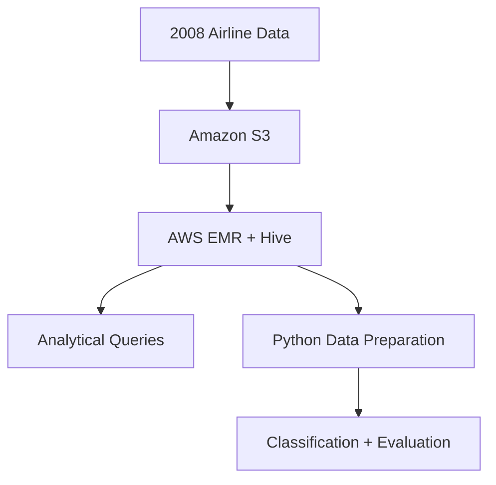
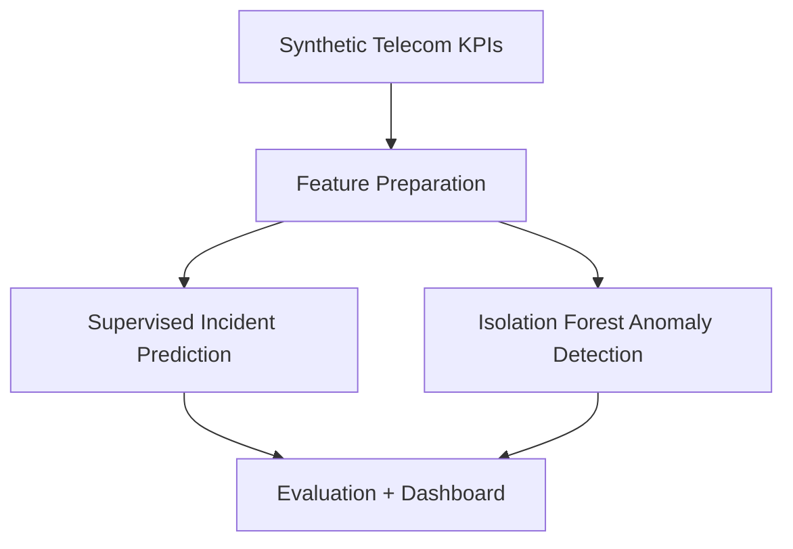

# Hritik Mathur — Data Science & Applied AI Portfolio

**Data Engineering · Data Science · Applied AI · Analytics**

M.S. Data Science, **Pace University (expected May 2027)** · Former Network Engineer, **Vodafone Idea Limited**

[GitHub profile](https://github.com/mathurhritik2507) · [LinkedIn](https://www.linkedin.com/in/hritikmathur/) · [Nagrik web beta](https://nagrik-eight.vercel.app/login)

## Professional Summary

I combine approximately three years of telecommunications engineering experience with graduate work in data science, machine learning, cloud analytics, and application development. My projects focus on reproducible data workflows, practical model evaluation, visualization, and operational problem-solving.

**Target roles:** Data Scientist, Data Engineer, Analytics Engineer, Applied AI/ML Engineer, Forward Deployed Engineer. **Target start:** Summer 2027.

## Portfolio Navigation

| Explore | What you'll find |
|---|---|
| [Cloud Data Engineering](https://github.com/mathurhritik2507/aws-big-data-analytics-pipeline) | AWS EMR, S3, Hive, preprocessing, analytical queries |
| [Network Intelligence](https://github.com/mathurhritik2507/ai-network-incident-prediction) | Incident-risk classification, anomaly detection, evaluation |
| [Civic Product Engineering](https://github.com/mathurhritik2507/Nagrik) | React Native, Expo, Firebase, web beta |
| [Full-Stack Prototypes](https://github.com/mathurhritik2507/swipe-to-help) | Product discovery, account flows, moderation concepts |
| [Forecasting](https://github.com/mathurhritik2507/time-series-forecasting-python) | Time-series analysis and forecasting |

## Architecture Snapshots

*These diagrams summarize separate portfolio workflows and are not claims of live production infrastructure.*

## Featured Repositories

| Project | Focus | Technologies | Repository |
|---|---|---|---|
| **NetOps GeoAI — Geospatial Network Intelligence** | Geospatial network operations visualization concept; dedicated public source/demo pending | Geospatial analysis, network intelligence, visualization | [Related repositories](https://github.com/mathurhritik2507?tab=repositories) |
| **NetOps AI: Incident Prediction & Anomaly Detection** | Predictive modeling and anomaly detection over simulated telecom KPIs; Streamlit dashboards and tests | Python, scikit-learn, Isolation Forest, Streamlit, GitHub Actions | [Explore](https://github.com/mathurhritik2507/ai-network-incident-prediction) |
| **AWS Big Data Analytics Pipeline** | Flight-delay analysis with S3/EMR/Hive and Python classification | AWS S3, EMR, Hive, Python, pandas, scikit-learn | [Explore](https://github.com/mathurhritik2507/aws-big-data-analytics-pipeline) |
| **Nagrik** | Civic engagement web/mobile beta with challenges and reporting interfaces | React Native, Expo, Firebase, Vercel | [Code](https://github.com/mathurhritik2507/Nagrik) · [Web beta](https://nagrik-eight.vercel.app/login) |
| **Swipe to Help** | Moderated assistance and startup-discovery product; public prototype and source-sync work in progress | Next.js, TypeScript, web app architecture | [Explore](https://github.com/mathurhritik2507/swipe-to-help) |
| **Foundry AI** | Founder discovery and collaboration prototype, not yet a production service | JavaScript, TypeScript | [Explore](https://github.com/mathurhritik2507/foundry-ai) |
| **Time Series Forecasting** | Forecasting analysis in Python | Python, time-series methods | [Explore](https://github.com/mathurhritik2507/time-series-forecasting-python) |
| **Network Incident Data Analysis** | KPI and incident-log analysis using simulated data | Python, pandas, Matplotlib | [Explore](https://github.com/mathurhritik2507/network-incident-data-analysis) |
| **AI ATS Resume Analyzer** | Resume/JD matching exploration | Applied AI, software prototyping | [Explore](https://github.com/mathurhritik2507/ai-ats-resume-analyzer) |
| **WEKA Machine Learning Classification** | Classification experiments and model evaluation | WEKA, machine learning | [Explore](https://github.com/mathurhritik2507/weka-machine-learning-classification) |
| **Public Safety Project** | Public-safety data exploration | Data science | [Explore](https://github.com/mathurhritik2507/Public-Safety-Project) |

### NetOps GeoAI — Separate Project

NetOps GeoAI is a geospatial network-intelligence application concept distinct from the **NetOps AI incident-prediction repository**. Its dedicated public repository or live demo has **not yet been verified**. Do not use the NetOps AI link as a GeoAI source-code link.

## What to Review First

For a technical review, start with the **NetOps AI** repository's training, evaluation, and anomaly-detection documentation. For cloud engineering, examine the **AWS flight-delay pipeline** and its Hive/Python workflow. For product development, explore **Nagrik** and its documented beta limitations.

## Technical Skills

- **Programming & analysis:** Python, SQL, R, pandas, NumPy, Jupyter, statistical analysis
- **Machine learning:** scikit-learn, classification, regression, clustering, anomaly detection, forecasting, model evaluation
- **Cloud & big data:** AWS S3, EMR, Hive, Hadoop, Spark, data pipelines
- **Visualization & applications:** Power BI, Matplotlib, Streamlit, React Native, Expo, Firebase, Next.js, Vercel
- **Operations:** network KPIs, incident analysis, firewall/VPN, monitoring, troubleshooting, technical coordination

## Professional Experience

**Vodafone Idea Limited — Network Engineering (~3 years)**

- Monitored and analyzed telecom KPIs, alarms, and traffic to support operational performance.
- Supported network change management, troubleshooting, and incident-response coordination.
- Worked with security and network operations data in high-availability environments.
- Contributed to improvements that reduced incident-resolution time from approximately eight hours to under two hours.

**Tata AutoComp Systems — Research Internship**

Contributed to automotive semiconductor-related research, experimental documentation, analysis, and technical reporting.

## Research Publication

**Bibliometric analysis on hand gesture firefighter assistance robots** — published research with **700+ reported downloads**.

This work reflects research methodology, technical literature analysis, and scientific communication. Publication reference: https://scholarworks.sjsu.edu/libphilprac/5584/ (confirm the paper metadata before citing externally).

## Education

**M.S. Data Science** — Pace University, New York · **Expected May 2027**  
**Bachelor's degree** — Electronics & Communication Engineering

## Contact

[LinkedIn](https://www.linkedin.com/in/hritikmathur/) · [GitHub](https://github.com/mathurhritik2507)

> **Portfolio transparency:** Some projects use synthetic datasets or are prototypes/beta builds. Repository READMEs describe current implementation status and limitations.
